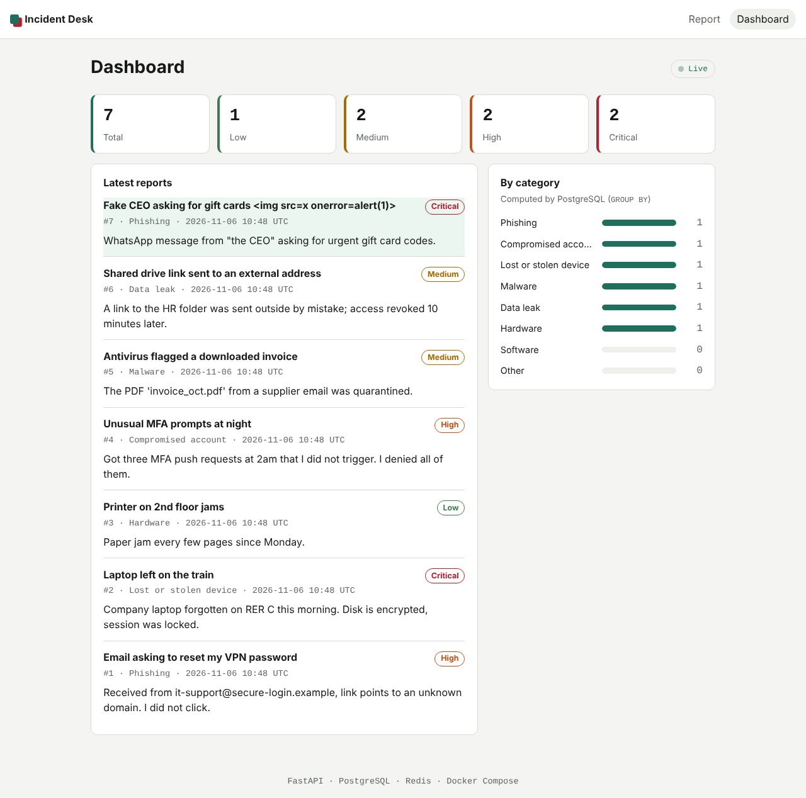

# Incident Desk

A security incident reporting portal, like an IT service desk form: employees
report a phishing email, a lost laptop or a suspicious login, and the IT team
watches a live dashboard.



Built for the NoSQL course at ENSIIE: **one web application, two databases
with distinct roles, orchestrated with Docker Compose and deployed on a VPS.**

| | |
|---|---|
| Application | Python 3.12, FastAPI, Jinja2, Pydantic |
| Data | PostgreSQL 17 (source of truth), Redis 7.4 (cache, rate limiting, live feed) |
| Delivery | Docker Compose, GitHub Actions, Ubuntu VPS (OVHcloud) |

## Quick start

Requirements: Git and Docker with Compose. No configuration file needed.

```bash
git clone https://github.com/HakeemMHB/incident-desk.git
cd incident-desk
docker compose up --build
```

Open http://localhost:8000. To look inside each database, follow
[docs/demo.md](docs/demo.md).

## Features

- **Report form** with server-side validation and a clear message per field.
- **Live dashboard**: new reports appear instantly in every open window
  (Redis Pub/Sub + Server-Sent Events), with counters per severity and a
  breakdown per category.
- **Rate limiting** per IP address, stored in Redis: 5 reports per minute by
  default, then HTTP 429.
- **Resilience**: if Redis goes down, reports are still saved and the
  dashboard reads PostgreSQL. If Redis loses its data, it is rebuilt from
  PostgreSQL automatically.
- **Security by default**: parameterized SQL, auto-escaped templates,
  Content-Security-Policy, non-root read-only container, databases not
  exposed, no secret in Git.

## Why two databases

| | PostgreSQL | Redis |
|---|---|---|
| Role | Source of truth: every report, in full | Fast layer: derived and short-lived data |
| Data | `reports` table, with CHECK constraints | Capped list of recent reports, severity counters, rate-limit counters, live channel |
| If lost | Data is lost: it is backed by a volume | Rebuilt from PostgreSQL |

MongoDB and Neo4j were considered and rejected: reports all share one fixed
structure and have no relationships between them. See the
[architecture decision records](docs/adr/).

## Design questions

**Why pull requests on a solo project?** `main` always works, so anyone can
clone it at any time; the CI runs on the pull request before the change
reaches `main`; and every change keeps its *what* and *why* in the pull
request, linked from the commit.

**Why is Redis suited to rate limiting, and PostgreSQL not?** `INCR` is
atomic, so two simultaneous requests cannot both read the same old value, and
`EXPIRE` makes Redis delete the counter itself at the end of the window. With
PostgreSQL, every request would be a disk write, and old rows would need a
cleanup job.

**If Redis goes down, should submissions be refused?** No: a lost security
report costs more than a few unthrottled requests. Reports are still saved in
PostgreSQL and the outage is logged. See
[ADR 003](docs/adr/003-keep-working-when-redis-is-down.md).

**How is SQL injection prevented?** Values are never inserted into the SQL
text: they travel separately as parameters (`%(title)s` in
[`app/db/postgres.py`](app/db/postgres.py)). A test stores
`x'); DROP TABLE reports; --` and checks it comes back as plain text.

**Why separate `/healthz` and `/readyz`?** `/healthz` says the process is
alive and never touches the databases: restarting the app would not fix a
database outage. `/readyz` says both databases answer, and names the one that
does not.

**Named volume or bind mount?** A named volume is managed by Docker and
independent of the host's folder layout; a bind mount maps a host folder. The
databases use named volumes, so the data survives `docker compose down`
(but not `down -v`).

**Why not run as root in the container?** If the application is compromised,
the attacker gets an unprivileged user in a read-only file system with no
Linux capabilities, instead of root.

**How does Redis persist its data?** With AOF (`appendonly yes`): every write
is appended to a log, flushed to disk every second, so a crash loses at most
about one second of writes. RDB snapshots alone could lose everything since
the last snapshot.

**Why `postgres:17-alpine` and not `latest`?** `latest` changes without
notice: a new major version could refuse the existing data files. A fixed
version gives the same result on every machine.

**Why an SSH key rather than a password?** A key cannot be guessed by brute
force, and the private part never leaves your machine. Password login is
disabled on the server, so bots trying passwords get nowhere.

## Tests

```bash
python -m venv .venv && source .venv/bin/activate
pip install -r requirements-dev.txt
pytest
```

Unit tests use in-memory fakes and need no database. Integration tests run
against real databases when `INTEGRATION_TESTS=1` is set. The CI runs both,
then starts the full stack with Docker Compose and checks that data reaches
both databases and survives a restart.

## Documentation

- [Architecture](docs/architecture.md): diagram, path of a submission, Redis keys
- [Demo procedure](docs/demo.md): the exact commands for each database
- [Deployment on a VPS](docs/deploy.md): server hardening and production setup
- [Architecture decision records](docs/adr/)

## How this project was built

Time-boxed, AI-assisted build. I set up the repository, the branch
protection and the pull request workflow, and made the architecture
decisions (ADRs 001 and 002) before any code was written. The implementation
was then generated with Claude (Anthropic) in a two-hour sprint, under my
direction. I reviewed it, ran the tests, deployed it and can explain every
choice above.

What this shows: delivering a working, tested and documented application
under a hard deadline, with the decisions kept in my hands. What it does not
show: writing every line myself. That is the goal of my next projects.

## License

[MIT](LICENSE)
