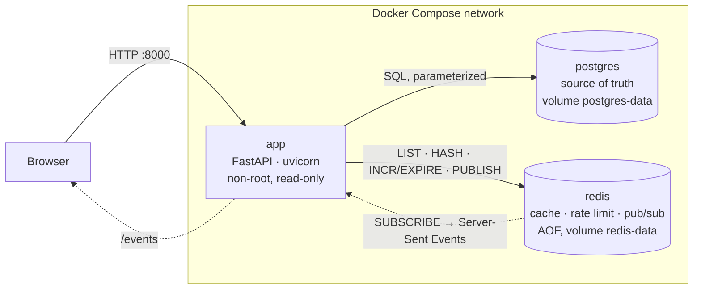

# Architecture

Only the application is published. The databases are reachable from the
Compose network only.

## Path of a submission

1. **Rate limit** (Redis): `INCR incidents:ratelimit:<ip>:<minute>`, then
   `EXPIRE 60`. Over the limit: HTTP 429 with `Retry-After`.
2. **Validation** (Pydantic, `app/models.py`): length limits, closed lists.
   Invalid: the form comes back with a message per field, HTTP 422.
3. **PostgreSQL** (`app/db/postgres.py`): parameterized `INSERT … RETURNING`.
   The table repeats the rules as CHECK constraints.
4. **Redis** (`app/db/cache.py`), in one MULTI/EXEC transaction:
   `LPUSH` + `LTRIM` (capped list), `HINCRBY` (counter), `PUBLISH` (live feed).
5. **Redirect** to `/reports` (HTTP 303, Post/Redirect/Get).

## Code layout

| File | Role |
|---|---|
| `app/main.py` | Routes, security headers, live feed, startup |
| `app/service.py` | How the two databases work together, failure policy |
| `app/db/postgres.py` | Schema and SQL queries |
| `app/db/cache.py` | Redis keys and commands |
| `app/models.py` | Validation rules |
| `app/config.py` | Settings from environment variables |
| `app/tests/` | Unit tests (fakes) and integration tests (real databases) |

## Redis keys

| Key | Type | Content |
|---|---|---|
| `incidents:recent` | List | The 10 latest reports, as JSON |
| `incidents:severity_counts` | Hash | One counter per severity |
| `incidents:ratelimit:<ip>:<minute>` | String | Attempts in that minute, expires after 60 s |
| `incidents:live` | Pub/Sub channel | New reports, for open dashboards |

## Failure policy

See [ADR 003](adr/003-keep-working-when-redis-is-down.md): Redis down means
degraded but working; PostgreSQL down means nothing is saved (HTTP 503).
